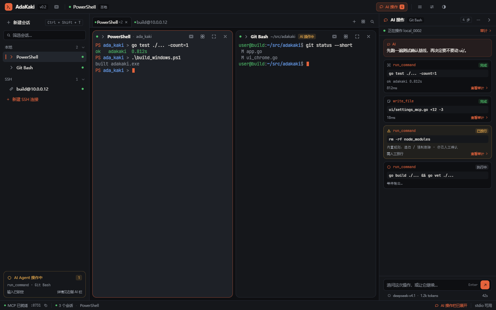
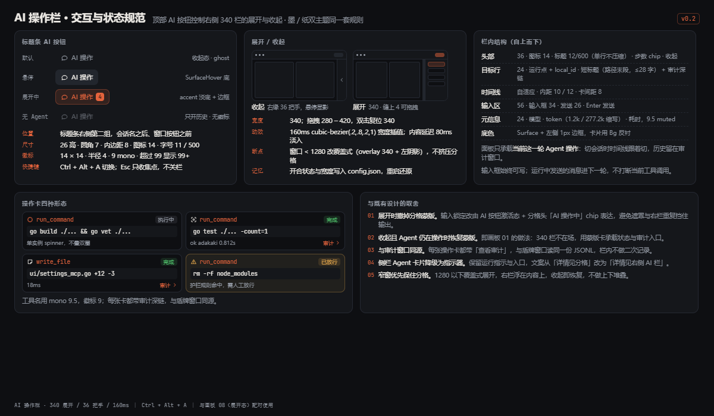
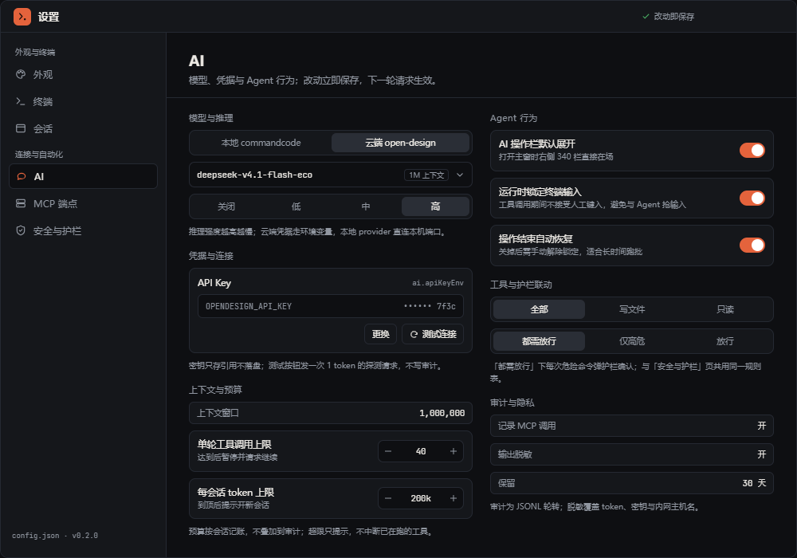
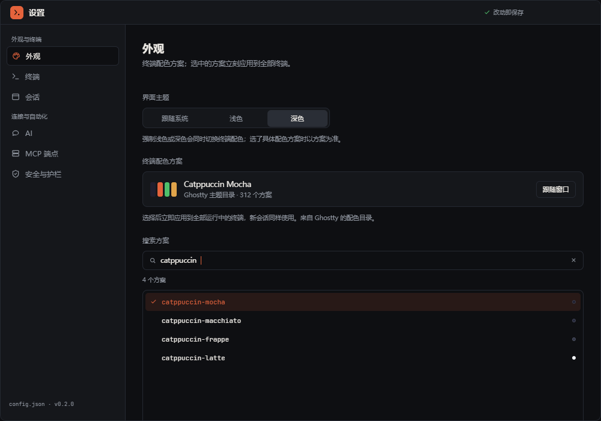

# AdaKaki AI 功能规划与设计（v0.2.1）

> 版本：v0.2（2026-11-14）
> 状态：设计已完成（画板 08–10 在 adago 画布上通过节点走查）；A1–A6 已按本设计落地，与实现的偏差见 §11
> 关联：[设计文档](./DESIGN.md) · [路线图](./ROADMAP.md) · [实施计划](./AI-实施计划.md) · [UI 设计图](./adakaki-ui-design.html)
> 设计源：画布 <http://127.0.0.1:8788>（项目「AdaKaki 控制台 UI v0.2」）；画板清单见 §4，截图见文末附录

---

## 1. 背景与目标

AdaKaki 目前的定位是「给 AI 用的终端」：它以 MCP 服务端身份把 12 个终端工具暴露给外部 Agent（stdio 与 HTTP 两种传输），人只在 GUI 里看结果。本阶段把它推进到「AI 也在场的终端」——**内置一个可配置的 AI 操作员**，在主窗口右侧逐条展示它的工具调用，人随时能看见、叫停、接管。

| 目标 | 含义 | 对应设计 |
|---|---|---|
| G1 可见 | 每一步工具调用、结果、耗时与审计入口都在右侧 AI 操作栏里成卡片呈现，不藏在日志里 | 画板 08 / 09 |
| G2 可控 | 护栏放行强度、输入锁定、自动恢复、工具范围、预算全部在设置页可配并即时生效 | 画板 10 / 04 |
| G3 可配 | 模型 provider、模型、推理强度、凭据引用统一抽象，本地与云端共用同一套接口 | 画板 10 §模型与推理 |

**非目标（v0.2.1 不做）**：多 Agent 并行、计划模式（Plan/Act 分离）、跨设备同步、语音与图像输入、自动改写代码（一切仍以工具调用为准）。

## 2. 范围

**做**：
1. AI 设置页（6 组配置，双列布局）与设置导航新增 AI 分类。
2. 右侧 AI 操作栏（340，可拖拽、可收起、按会话切换）、顶部 AI 按钮（四态 + 徽标）。
3. 进程内工具执行层：把 `internal/mcp` 里已有的工具实现抽成可复用注册表，MCP 传输与进程内 Agent 共用。
4. 模型接入：OpenAI-completions 兼容的流式客户端，本地 provider 与云端 provider 同一接口。
5. 护栏联动：放行强度模式（都需放行 / 仅高危 / 放行）映射到现有 `guard.Policy`。
6. 审计联动：进程内调用复用 `audit.Entry`，不新增字段、不迁移历史文件。
7. 预算：单轮工具调用上限、每会话 token 上限、上下文窗口展示。

**不做**：MCP 协议层改动（工具名与语义保持不变）；审计 schema 变更；多模型并行对比。

## 3. 现状基线（代码事实）

| 能力 | 现状 | 代码落点 |
|---|---|---|
| MCP 服务端 | stdio + Streamable HTTP；12 工具：`list_shells` / `list_sessions` / `create_session` / `ssh_connect` / `list_ssh_profiles` / `write_session` / `read_session` / `screen_session` / `resize_session` / `close_session` / `reconnect_session` / `run_command` | `internal/mcp/{server,tools,adapter}.go` |
| 护栏 | `deny` / `confirm` 两级；`Policy.Check` → `allow`/`confirm_ok`/`deny`；GUI 侧 `Confirm` 回调决定放行 | `internal/guard/guard.go` |
| 审计 | JSONL 追加 + 5 MB × 3 轮转；`Entry` 含 time/transport/client/tool/args/session/command/ok/error/guard/output_bytes/duration_ms | `internal/audit/audit.go`，注入点 `mcp.Hooks.Audit` |
| 设置 | 5 个分类（外观 / 终端 / 会话 / MCP 端点 / 安全与护栏），分两组，改动即存 | `ui/settings_view.go`（`settingsGroups`）、`ui/settings_*.go` |
| 蒙版 | 分格级 Agent 操作遮罩 + “详情见分格”入口 | `ui/ui_pane_card.go`、`ui/ui_sidebar.go` |
| 模型客户端 | **无** | — |
| Agent 循环 | **无**（只有被动响应外部 MCP 调用） | — |
| 进程内工具层 | **无**（工具实现绑在 MCP 适配器里） | `internal/mcp/adapter.go` |

结论：AI 不是从零造，而是**复用已成型的工具面（12 工具 + 护栏 + 审计），补上模型侧与呈现侧**。

## 4. 设计输入：画板与功能映射

| 画板 | 关键规格 | 覆盖功能 |
|---|---|---|
| **08** 主窗口 + 右侧 AI 操作栏（1440×900，`desktop-app` 画板，走查 100） | dock 340；头 36 / 目标行 24 / 时间线自适应 / 输入 56 / 元信息 24；操作卡四形态；分格头「AI 操作中」chip | F1 / F3 / F6 |
| **09** AI 操作栏交互规范（1200×700，走查 90） | AI 按钮 26 高四态；徽标 14×14；收起把手 36；展开 340（拖 280–420）；动效 160ms；断点 1280；`Ctrl + Alt + A` | F2 |
| **10** 设置窗口 · AI 页（1000×700，走查 90） | 6 组：模型与推理 / 凭据与连接 / 上下文与预算 / Agent 行为 / 工具与护栏联动 / 审计与隐私；每行标注配置键 | F4 / F5 / F6 / F7 |
| **04** 设置窗口 · 外观页（含新增 AI 分类） | 导航「连接与自动化」组：AI → MCP 端点 → 安全与护栏 | F4 |









## 5. 功能分解

### F1 · AI 操作栏（右侧 dock）

- **职责**：把当前会话这一轮 Agent 的操作渲染成可读的时间线，并提供追问入口。
- **结构**（与画板 08 一致）：头 36（图标 + 「AI 操作」+ 目标会话 chip + 步数 + 更多 + 收起）→ 目标行 24（运行点 + `local_id` + 审计深链）→ 时间线（AI 发言、工具卡、护栏卡、运行中卡）→ 输入区 56（追问框 34 + 发送 26 + `Enter` 提示）→ 元信息 24（模型 · token · 耗时）。
- **数据来源**：`agent.Event` 流（§7.2），不直接读审计文件；切换会话时时间线整体替换。
- **边界**：只渲染**当前轮**；历史留在审计窗口（画板 05）。时间线不做虚拟滚动（单轮 ≤ 40 卡，见 F7）。
- **落点**：`ui/ai_dock.go`（视图）、`ui/app_ai.go`（事件与状态）。

### F2 · 顶部 AI 按钮与开合

- **职责**：标题条上的唯一 AI 入口，开合 dock、显示本轮步数、暴露“无 Agent”态。
- **四态**（画板 09）：默认 ghost / 悬停 SurfaceHover / 展开中 accent 淡底 + 边框 + 徽标 / 无 Agent（只开历史，无徽标）。
- **尺寸**：26 高 · 圆角 7 · 内边距 8 · 图标 14 · 字号 11/500；徽标 14×14 · 半径 4 · 9 mono · >99 显示 `99+`。
- **开合**：`Ctrl + Alt + A` 切换；`Esc` 只收输入焦点不关栏；状态与宽度写入 `config.json`（`ai.dock_open` / `ai.dock_width`）。
- **断点**：窗口 < 1280 时覆盖式展开（overlay 340 + 左阴影），不挤压分格。
- **落点**：`ui/ui_header.go`（按钮）、`ui/ui_main.go`（dock 挂载与断点）。

### F3 · 工具执行与操作卡事件流

- **职责**：把一次工具调用从“开始”到“结束”投射成卡片，并保证与真实执行一致（不伪造成功）。
- **事件**：`tool_started` → `tool_finished`（ok / error / denied / confirm_ok）；卡片形态见画板 09 的四形态。
- **一致性**：卡片状态直接来自执行结果；`denied` 必须显示护栏原因并给出「查看审计」；`error` 显示上游错误文本（经脱敏）。
- **落点**：`internal/agent/loop.go`（发事件）、`ui/ai_dock.go`（渲染）。

### F4 · AI 设置页

- **职责**：给 F1–F7 的全部可调项提供 UI，并即时写入配置。
- **结构**（画板 10）：双列 6 组，沿用既有控件（分段 / 下拉 / 开关 / 步进 / 凭据卡）。
- **校验**：数值范围（单轮 1–200、token 上限 1k–1M、dock 宽度 280–420）；非法值不落盘，行内提示。
- **落点**：`ui/settings_ai.go`；导航项注册在 `ui/settings_view.go` 的 `settingsGroups`（连接与自动化组，AI 在 MCP 端点之前）。

### F5 · 模型与凭据

- **职责**：屏蔽 provider 差异；凭据只存引用。
- **provider**：`local`（默认 `http://127.0.0.1:3050/v1`，OpenAI-completions 兼容）与 `cloud`（`base_url` 可配）。同一 `chat/completions` 协议，流式读取。
- **凭据**：两种来源，**直接保存优先**。① 设置 → AI 直接粘贴 API Key，经 Windows DPAPI 加密写入 `config.json` 的 `ai.api_key_dpapi`（只有本机本用户可解密，界面只显示「已保存（DPAPI 加密）」不回显明文）；② 可选的环境变量兜底（`ai.api_key_env` 只存变量名）。旧版本把 Key 粘在环境变量框里的配置，启动时自动迁入加密槽。
- **推理强度**：`off|low|medium|high` 透传为请求参数；模型不支持时 UI 置灰该档。
- **落点**：`internal/ai/{provider.go,client.go,credentials.go}`。

### F6 · 护栏联动

- **职责**：进程内 Agent 与外部 MCP 客户端用**同一份** `guard.Policy`，无旁路。
- **放行强度三档**（画板 10）：
  | UI | `guard` 行为 | 说明 |
  |---|---|---|
  | 都需放行 | 所有 `confirm` 级规则都走 `Confirm` 回调（GUI 弹护栏对话框） | 默认 |
  | 仅高危 | 仅 `deny` 级先弹一次确认，其余 `confirm` 直接允许 | 少打断 |
  | 放行 | `Policy.Enabled = false` | 仅调试，状态条常显警示 |
- **确认通道**：复用 `ui/app_dialogs.go` 的护栏问答；Agent 协程阻塞等待，取消（Esc / 会话关闭）视为 `deny`。
- **落点**：`internal/guard/guard.go` 增加 `Mode` 字段 + 映射函数；`ui/app_dialogs.go` 复用现有对话框。

### F7 · 上下文预算与用量

- **职责**：防止一轮跑飞、一会话烧穿。
- **上下文窗口**：只读展示（默认 1,000,000，来自模型）。
- **预算上限（已移除）**：设置页不再提供单轮工具数与每会话 token 两个步进（v0.2.2 按使用反馈移除），运行时**默认不设上限**；`ai.max_tool_calls` / `ai.session_token_limit` 仍保留在配置里，手改为正数即重新生效（单轮 1–200、token 1k–1M），0 = 不限制。
- **计量**：provider 返回的 usage 为准；无 usage 时按字符估算（`~1 token / 2.5 CJK 字符`）并在元信息标注 `≈`。
- **落点**：`internal/agent/budget.go`、`internal/ai/tokens.go`。

## 6. 交互规格

### 6.1 状态机

```
Dock:   closed ──toggle──► opening(160ms) ──► open ──toggle──► closing(160ms) ──► closed
Run:    idle ──submit──► thinking ──tool──► tool_running ──► thinking … ──► done | error | aborted
Lock:   run ∈ {thinking,tool_running} && ai.lock_input ──► 分格输入锁定
恢复:   run ∈ {done,error,aborted} && ai.auto_restore ──► 解除锁定（延迟 ≤ 120ms）
```

### 6.2 关键参数

| 项 | 值 | 出处 |
|---|---|---|
| dock 宽 | 340（拖 280–420，双击复位 340） | 画板 09 |
| 开合动效 | 160ms `cubic-bezier(.2,.8,.2,1)`，内容延迟 80ms 淡入 | 画板 09 |
| 覆盖式断点 | 窗口宽度 < 1280 | 画板 09 |
| 收起把手 | 36 × 全高，悬停显影 | 画板 09 |
| 快捷键 | `Ctrl + Alt + A` 切换；`Esc` 收焦点 | 画板 09 |
| 输入框 | 34 高，`Enter` 发送、`Shift + Enter` 换行 | 画板 08 |
| 操作卡 | 工具名 mono 9.5 / 徽标 9 / 卡片间距 8 | 画板 09 |

### 6.3 异常与恢复

| 场景 | 表现 | 恢复 |
|---|---|---|
| provider 连不上 / 鉴权失败 | 时间线首条红色系统卡，输入框保留草稿 | 设置页「测试连接」；按钮回到“无 Agent”态 |
| 工具超时（默认 60s，`run_command` 120s） | 卡片标 `超时`，附「重试」 | 重试走同一护栏判定 |
| 护栏拒绝 | 卡片琥珀色 + 原因 + 查看审计 | 改设置或换命令 |
| 单轮工具数到顶 | 时间线尾卡「已达 40 步」，停止 | 「继续」按钮追加一轮预算 |
| 会话被关闭 | Agent 收到取消 → `aborted` | 输入解锁，卡片标「已中止」 |

## 7. 数据与接口

### 7.1 `config.json` 新增 `ai` 段（旧配置缺段时取默认）

| 键 | 类型 | 默认 | UI 行 | 说明 |
|---|---|---|---|---|
| `enabled` | bool | `false` | —（功能开关） | 关闭时标题条不显示 AI 按钮 |
| `provider` | `"local"｜"cloud"` | `local` | 模型与推理 · 提供方 | — |
| `base_url` | string | `http://127.0.0.1:3050/v1` | 模型与推理 · 高级 | 云端时必填 |
| `model` | string | `deepseek-v4.1-flash-eco` | 模型与推理 · 模型 | — |
| `reasoning` | `off｜low｜medium｜high` | `high` | 模型与推理 · 推理强度 | — |
| `api_key_env` | string | `OPENDESIGN_API_KEY` | 凭据与连接 · 或环境变量 | 作为兜底的环境变量名；直接保存的 Key 优先 |
| `api_key_dpapi` | string（base64） | — | 凭据与连接 · API Key | 直接填写的 Key，经 Windows DPAPI 加密后落盘；设置页只显示「已保存」状态，不回显明文 |
| `context_window` | int | `1000000` | 上下文与预算 | 展示用 |
| `max_tool_calls` | int | `0`（不限制） | （已从设置页移除，配置可选） | 单轮工具数上限；0 = 不限制 |
| `session_token_limit` | int | `0`（不限制） | （已从设置页移除，配置可选） | 每会话 token 上限；0 = 不限制 |
| `dock_open` | bool | `true` | Agent 行为 | 重启还原 |
| `dock_width` | int | `340` | （拖拽写入） | 280–420 |
| `lock_input` | bool | `true` | Agent 行为 | 运行中锁终端 |
| `auto_restore` | bool | `true` | Agent 行为 | 结束自动恢复 |
| `tool_scope` | `all｜write｜readonly` | `all` | 工具与护栏联动 | 白名单语义见 O3 |
| `guard_mode` | `confirm_all｜high_only｜allow` | `confirm_all` | 工具与护栏联动 | §F6 映射 |
| `audit_enabled` | bool | `true` | 审计与隐私 | — |
| `audit_redact` | bool | `true` | 审计与隐私 | 覆盖 token/密钥/内网主机 |
| `audit_retention_days` | int | `30` | 审计与隐私 | 轮转清理阈值 |

### 7.2 运行时事件（`agent.Event`，UI 内部消费，不落盘）

```json
{ "kind": "tool_started",  "turn": 3, "seq": 1, "tool": "run_command", "cmd": "go test ./... -count=1", "target": "local_0002" }
{ "kind": "tool_finished", "turn": 3, "seq": 1, "ok": true, "duration_ms": 812, "output_bytes": 42, "audit_id": 1102 }
{ "kind": "turn_done",     "turn": 3, "tokens": 1240, "tool_calls": 4, "stopped": "budget|user|error|" }
```

### 7.3 审计

- **不改 schema**：进程内调用写 `Transport: "inapp"`、`Client: "adakaki-ai"`，其余字段沿用（`Guard` 仍填 `denied:<reason>`）。
- 轮次信息放 `Args` 的内嵌 JSON（`{"turn":3}`），避免历史文件迁移。
- 深链：操作卡的「查看审计」按 `(time, tool, session)` 定位到审计窗口同一行（画板 05 已有筛选能力）。

### 7.4 与 MCP 契约的关系

- 工具名、参数与返回语义**不变**；进程内 Agent 只新增一条调用入口，不改协议。
- 同一 `Hooks`（Guard/Audit）注入两个入口，避免双份规则表。

## 8. 代码落点（文件级）

| 动作 | 文件 | 说明 |
|---|---|---|
| 新增 | `internal/ai/provider.go` `client.go` `credentials.go` `tokens.go` | provider 抽象、流式 chat、环境变量凭据、token 计量 |
| 新增 | `internal/agent/loop.go` `budget.go` `prompt.go` | Agent 循环、预算、系统提示（终端上下文摘要） |
| 新增 | `internal/tools/registry.go` `terminal.go` `ssh.go` | 从 `internal/mcp/adapter.go` 抽出的工具实现（MCP 与 Agent 共用） |
| 修改 | `internal/mcp/adapter.go` | 改为调用 `internal/tools`，行为不变（回归测试守住） |
| 修改 | `internal/guard/guard.go` | 增加 `Mode` 与 `ApplyMode` |
| 修改 | `internal/store/store.go` | 增加 `Settings.AI` 结构（§7.1） |
| 新增 | `ui/ai_dock.go` `ui/settings_ai.go` `ui/app_ai.go` | 右栏视图、AI 设置页、状态与事件派生 |
| 修改 | `ui/ui_main.go` | dock 挂载与 <1280 覆盖式断点 |
| 修改 | `ui/ui_header.go` | 顶部 AI 按钮四态 |
| 修改 | `ui/ui_pane_card.go` | dock 展开时去蒙版、改为「AI 操作中」chip |
| 修改 | `ui/settings_view.go` | `settingsGroups` 增加 AI 分类 |
| 修改 | `ui/ui_theme.go` | dock 尺寸常量（340/36/24/56/24） |
| 修改 | `ui/icons.go` | 新增 `icoMessage`（画板用气泡图标；现有 `icoBot` 可作备选） |
| 修改 | `docs/DESIGN.md` | 架构变更回写：新增 `internal/ai|agent|tools` 三包与 dock |

## 9. 验收标准

**设计一致性（逐画板核对）**
1. dock 340、头 36、目标行 24、输入 56、元信息 24；两列分格在 1440 宽窗口下等分（画板 08）。
2. AI 按钮四态、徽标 14、`.ai-btn` 26 高与标题条其余控件同高（画板 09）。
3. 设置页 6 组齐全、每行标注配置键、改动即存、非法值不落盘（画板 10）。
4. 设置导航顺序：AI → MCP 端点 → 安全与护栏（画板 04）。
5. 节点走查：新建相关画板 ≥ 90 分且无失败项（现有 08 = 100，09/10 = 90，唯一警告为窗口尺寸稿无画板契约）。

**功能用例（手工验收清单）**

| # | 用例 | 期望 |
|---|---|---|
| U1 | 点 AI 按钮 | dock 160ms 展开，按钮切 accent 态，步数徽标出现 |
| U2 | `Ctrl + Alt + A` | 与 U1 等价；再按收起，宽度记忆保留 |
| U3 | 窗口缩到 1200 | dock 覆盖式展开，分格不挤压 |
| U4 | 提交“跑一遍测试” | 时间线出现 thinking → run_command 卡 → 完成徽标 + 耗时 + 审计深链 |
| U5 | 触发 `rm -rf` 类命令 | 护栏对话框弹出；拒绝 → 卡片 `denied:原因`；允许 → `已放行` |
| U6 | 运行中点终端 | 输入被锁定；结束后 ≤120ms 恢复 |
| U7 | 关掉 `lock_input` | 运行中仍可键入，卡片照常 |
| U8 | 单轮跑到 40 步 | 停止并显示「已达 40 步」+ 继续按钮 |
| U9 | token 到 200k | 提示开新会话，当前工具不被打断 |
| U10 | 断网/错 key | 首条系统卡报错；「测试连接」给出上游原因 |
| U11 | 关闭 `ai.enabled` | 标题条无 AI 按钮，dock 不挂载，MCP 服务端照常 |
| U12 | MCP 外部客户端调用 | 行为与 v0.2 完全一致（12 工具回归） |

**质量门**：`go build ./...` / `go vet ./...` / `go test ./...` 全绿 + GUI 冒烟存活 + README 功能清单更新 + `DESIGN.md` 回写。

## 10. 风险与未决

| # | 风险 | 影响 | 缓解 |
|---|---|---|---|
| R1 | 工具实现从 `internal/mcp/adapter.go` 抽出时行为漂移 | MCP 客户端回归 | 先抽 `internal/tools` 并让 adapter 变薄壳，用现有 `mcp` 测试作为护栏 |
| R2 | 流式响应与取消在 GUI 主线程上处理不当 | 卡帧、无法中止 | provider 读取在独立 goroutine，UI 只消费事件；取消用 `context` |
| R3 | 双层遮罩（dock + 蒙版）导致输出被挡 | 可用性倒退 | 设计已定：dock 展开撤蒙版，收起且运行中恢复蒙版（画板 09 取舍 01/02） |
| R4 | 预算计量不准（无 usage 时估算） | 用户困惑 | 估算值带 `≈` 标记；设置页写清口径 |
| R5 | 云端凭据误入配置文件 | 泄密 | 只存环境变量名；审计与操作卡统一脱敏 |

**未决问题**
- O1 流式协议细节：SSE 增量按 delta 累积，还是按段落渲染？（建议段落级渲染，降低重排）。
- O2 一轮是否会跨多个会话？（建议 v0.2.1 只操作“目标会话”一个，切换会话即开新一轮）。
- O3 `tool_scope` 语义：`write` 指“允许写文件与执行命令、禁止创建/关闭会话”？需要在实现前与护栏规则对齐。
- O4 无 usage 时的估算系数是否需要可配？
- O5 与 ROADMAP P16（stdio 代理）的关系：进程内 Agent 不依赖代理，两者可并行。

## 11. 实现状态与偏差（v0.2.1 落地）

A1–A6 已完成并分阶段提交（提交信息以 `AI A<n>` 开头），`DESIGN.md` 已补 §4.7「AI 操作员」。落地时与本设计的差异如下：

| # | 设计 | 落地现状 | 影响 |
|---|---|---|---|
| 1 | 设置页双列（画板 10） | **单列**，与其它设置分类同一节奏 | 观感；功能不受影响 |
| 2 | 模型下拉 | **文本输入** | 无模型目录接口前避免假选择器 |
| 3 | UI 流式渲染 | 回合使用**非流式**（`ai` 客户端已支持 SSE；事件模型已按增量设计） | 长回答等待更久；后续接流式不动事件层 |
| 4 | `<1280` 覆盖式 dock | 未实现（当前一律挤压式） | 窄窗体验待补 |
| 5 | dock 头「更多」菜单 | 未实现 | 少一个入口，不影响主流程 |
| 6 | `ai.lock_input` / `ai.auto_restore` 生效 | 只写入配置；引擎锁仍由 tool tracker 一次性开关 | 关掉开关目前不会放宽锁定 |
| 7 | `ai.audit_retention_days` 清理 | 只写入配置 | 审计仍按 5MB×3 轮转 |
| 8 | 会话 token 计数 | 内存计数，重启归零 | 预算跨重启不连续 |
| 9 | 画板 10「API Key 环境变量」行 | 实现改为「API Key 直接填写（DPAPI 加密）+ 或环境变量」 | v0.2 追加：用户要求直接保存 Key；画板待同步更新 |
| 10 | 画板 10 的两条预算步进 | **已移除**（上下文窗口保留为只读），运行时默认不设上限 | v0.2.2 追加：按使用反馈移除；配置键保留，手改仍生效 |

已落实的关键契约：`tools.Specs()` 与 MCP 目录 schema 深度一致（测试锁定）；护栏三档与 MCP 共用策略；GUI 确认通道 `confirmGuard` 真正接线；审计 `inapp`/`adakaki-ai` 且对 `password/token/secret` 字段脱敏。

---

## 附录：设计画板（导出与截图）

- 画布：<http://127.0.0.1:8788>（项目 `p-1794620970582-0001`，10 个画板）
- 离线导出：`board-20261114-101702.html`（10 画板，204,778 字节）
- 截图：本目录 `assets/ai/` 下 4 张（dock 展开态、交互规范、AI 设置页、设置导航）
